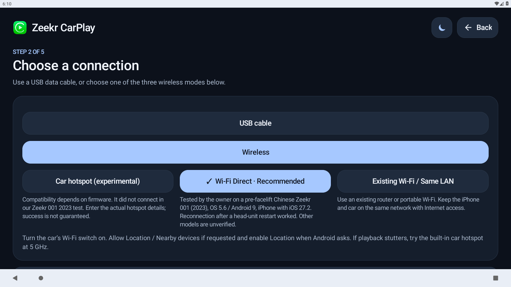
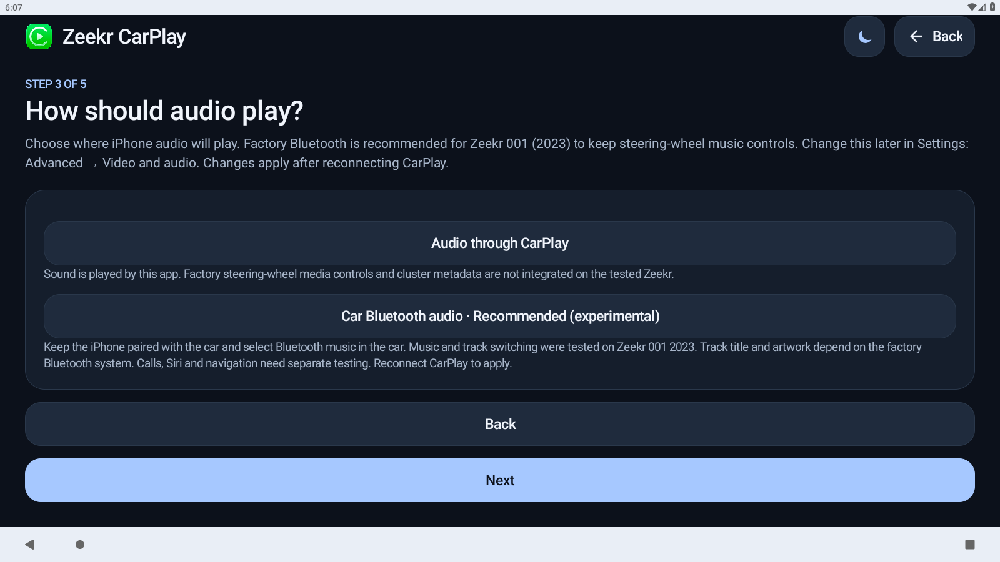
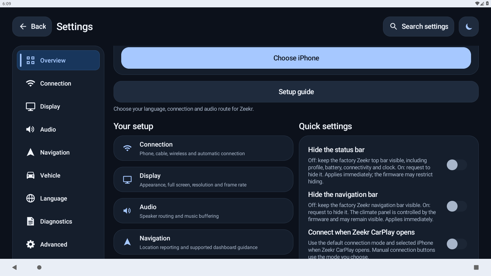
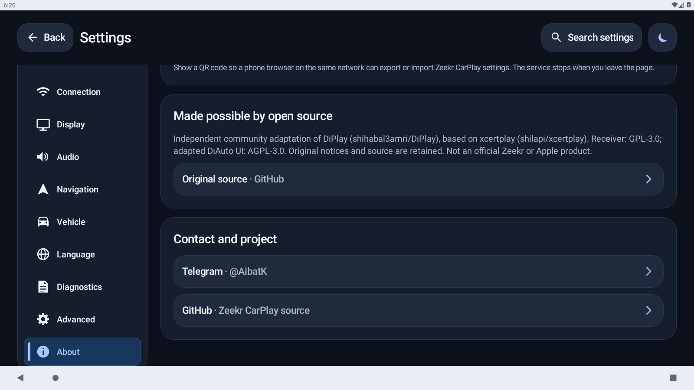

# Zeekr CarPlay

[Русский](README.md) · **English**

A CarPlay receiver for the Zeekr Android head unit. An open-source project. Current version: **Final Alpha 03**, package `com.openzeekr.carplay`.

## Download and install

**[Download APK — Final Alpha 03](https://github.com/KrykByte/zeekr-carplay/releases/download/final-alpha-03/OpenZeekr-CarPlay-Final-Alpha-03.apk)** · [Release and source archive](https://github.com/KrykByte/zeekr-carplay/releases/tag/final-alpha-03)

1. Download `OpenZeekr-CarPlay-Final-Alpha-03.apk` and install it on the car head unit.
2. Update an existing `com.openzeekr.carplay` installation in place to retain settings.
3. Choose Russian or English and complete the setup guide.
4. For the tested vehicle, select **Wireless → Wi-Fi Direct**, then **Car Bluetooth audio**. Keep the iPhone paired with the factory Bluetooth system and select Bluetooth music in the car.

The APK is sufficient for installation; no separate certificate/key import is needed.

## Compatibility

Owner-tested on a **Chinese pre-facelift Zeekr 001, model year 2023, Zeekr OS 5.6 / Android 9**. The owner confirmed Wi-Fi Direct with factory Bluetooth audio, steering-wheel track controls and reconnection after a head-unit restart.

**Compatibility with other models, model years and firmware versions is unknown.** Calls, Siri and navigation prompts require separate testing. Each new build/device configuration also requires validation on the car.

You may download the APK and source, study the code, modify the application and develop your own versions under the component licenses. Participants test compatibility with other vehicles and implement improvements independently.

**The maintainer cannot test other vehicles and does not provide individual support. Please do not send the maintainer logs, builds or requests to test other cars.**

## Factory bars and fullscreen mode

Choose whether to keep the factory interface visible:

1. Open the app → **Settings → Overview → Quick settings**.
2. **Hide the status bar: Off** keeps the top factory bar visible. On requests hiding it.
3. **Hide the navigation bar: Off** keeps the factory navigation bar visible. On requests hiding it.
4. Enable both for fullscreen mode; disable them to restore the bars. The same controls are available under **Display**.

Changes apply immediately. Firmware controls whether a particular bar can be hidden; the climate panel may remain visible. Bars are shown by default on a fresh installation. Inside CarPlay, a three-finger downward swipe opens app settings when that gesture is selected.

## Screenshots

Application screens captured on an Android emulator. They do not show Zeekr's proprietary system bars or demonstrate an iPhone connection in the emulator.

| Connection | Audio |
| --- | --- |
|  |  |

| Quick settings | About |
| --- | --- |
|  |  |

## Source and credits

- [DiPlay by shihabal3amri](https://github.com/shihabal3amri/DiPlay), base commit `615b32ce0b40cd0b99ce94ba23a512001553684f` (0.2.22).
- [xcertplay by shilapi](https://github.com/shilapi/xcertplay), the underlying receiver.
- [DiAuto](https://github.com/shihabal3amri/DiAuto), credited for adapted UI elements.

Documentation: [build instructions](docs/BUILD.md), [Zeekr CarPlay](docs/ZEEKR-CARPLAY.md), [original DiPlay README](docs/DIPLAY-README.md), [xcertplay README](docs/UPSTREAM-README.md).

Validation: **3,543 tests passed, one skipped**; required lint and application builds succeeded. Source builds contain no CarPlay runtime certificate/key by default and need separately provisioned runtime inputs for standalone authentication. Those inputs are stored in a separate release attachment. The Android APK-signing key is not uploaded.

## Licenses

[LICENSE](LICENSE), [component notices](docs/THIRD_PARTY_NOTICES.md) and original authorship are retained. The receiver uses GPL-3.0; adapted UI carries AGPL-3.0 terms. Some assets have separate terms; code licenses do not automatically grant trademark or runtime-asset distribution rights.

Independent community software, not an official Zeekr or Apple product.

Adaptation maintainer: **[Telegram @AibatK](https://t.me/AibatK)**.
