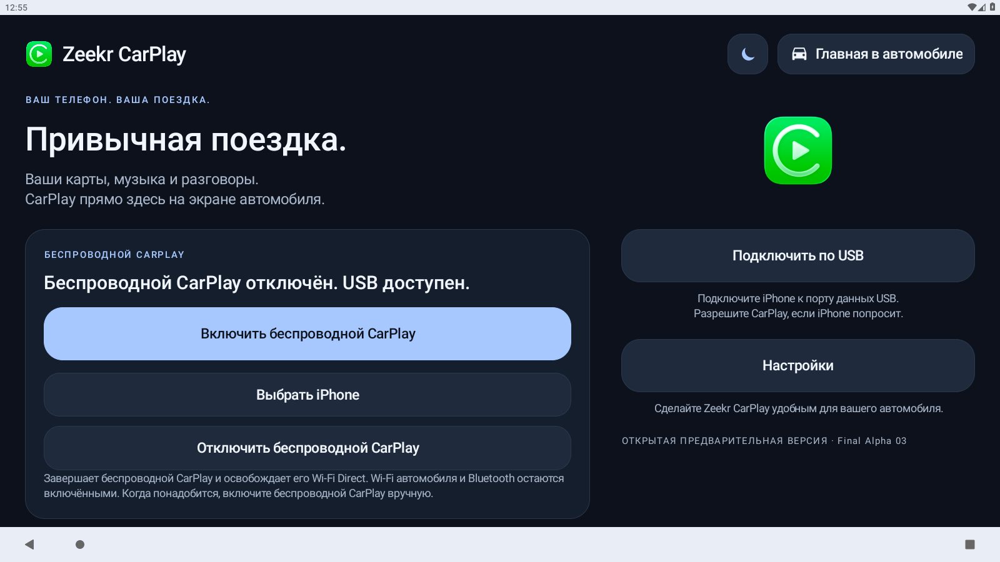

# Zeekr CarPlay

**Русский** · [English](README.en.md)

Я адаптировал DiPlay для своего Zeekr и выложил приложение вместе с исходниками. Актуальная версия — **Final Alpha 03**, пакет `com.openzeekr.carplay`.

## Скачать и установить

**[Скачать APK — Final Alpha 03](https://github.com/KrykByte/zeekr-carplay/releases/download/final-alpha-03/OpenZeekr-CarPlay-Final-Alpha-03.apk)** · [Релиз и исходники](https://github.com/KrykByte/zeekr-carplay/releases/tag/final-alpha-03)

1. Скачайте `OpenZeekr-CarPlay-Final-Alpha-03.apk` и установите на головное устройство автомобиля.
2. Если приложение с пакетом `com.openzeekr.carplay` уже установлено, обновите его поверх — настройки сохранятся.
3. Выберите русский или английский язык и пройдите мастер настройки.
4. Для проверенного автомобиля выберите **беспроводное подключение → Wi-Fi Direct**, затем **звук через Bluetooth автомобиля**. Оставьте iPhone сопряжённым со штатным Bluetooth и выберите Bluetooth-музыку в автомобиле.

Для установки достаточно APK: отдельно импортировать сертификаты и ключи не нужно.

## Совместимость

Я проверил приложение на своём **китайском Zeekr 001, 2023 год, дорестайлинг, Zeekr OS 5.6 / Android 9**. У меня стабильно работают Wi-Fi Direct и звук через штатный Bluetooth, переключаются треки с руля и восстанавливается подключение после перезагрузки головного устройства.

**На других автомобилях и прошивках я приложение не проверял и не знаю, как оно будет работать.** Звонки, Siri и навигационные подсказки я отдельно не подтверждал. Новые сборки и конфигурации тоже нужно проверять на машине.

Я оставляю проект с открытым исходным кодом. Скачивайте APK и исходники, изучайте, переделывайте и улучшайте приложение для своих машин. Сохраняйте первоисточники и соблюдайте лицензии компонентов. Если хотите адаптировать приложение для другого автомобиля, тестируйте и дорабатывайте его самостоятельно.

У меня есть возможность проверять приложение только на своём Zeekr, поэтому совместимость с другими машинами я подтвердить не могу. Буду рад, если проект пригодится вам как готовое решение или основа для собственных доработок.

## Отключить беспроводной CarPlay

На главном экране нажмите **«Отключить беспроводной CarPlay»**. Приложение завершит беспроводную сессию и запросит удаление только своей группы Wi-Fi Direct. После подтверждения удаления появится сообщение об освобождении Wi-Fi Direct. Если удалить группу не удалось, приложение сообщит об этом; отключение можно повторить.

Беспроводной автозапуск останется выключенным до ручного включения. Для возврата нажмите **«Включить беспроводной CarPlay»**. При выборе USB в мастере, нажатии **«Подключить по USB»** или запуске по USB-кабелю приложение также освобождает свою группу перед запуском проводного режима. Текущая USB-сессия не останавливается кнопкой отключения беспроводного режима.

Общие переключатели Wi-Fi и Bluetooth не выключаются. Штатная точка доступа и соединения других приложений, в том числе ZeekrTV, не удаляются. Это временный способ освободить ресурсы CarPlay перед передачей файлов, а не подтверждённое исправление причины лагов при работе ZeekrTV. На автомобиле эту функцию ещё нужно проверить.

## Системные панели и полноэкранный режим

Видимость штатного интерфейса можно менять по желанию:

1. Откройте приложение → **Настройки → Обзор → Быстрые настройки**.
2. **«Скрыть панель состояния» выключено** — верхняя штатная панель видна. Включено — приложение запрашивает её скрытие.
3. **«Скрыть панель навигации» выключено** — штатная панель навигации видна. Включено — приложение запрашивает её скрытие.
4. Для полноэкранного режима включите оба переключателя. Чтобы вернуть панели, выключите их. Те же настройки есть в разделе **«Экран»**.

Изменения применяются сразу. Возможность скрыть панель зависит от прошивки; климатическая панель может оставаться видимой. На новой установке скрытие выключено. Из CarPlay настройки приложения открываются жестом вниз тремя пальцами, если этот жест выбран в настройках.

## Скриншоты

Снимки приложения в Android-эмуляторе. Они не показывают фирменные панели Zeekr и не подтверждают подключение iPhone в эмуляторе.

| Подключение | Звук |
| --- | --- |
|  |  |

| Быстрые настройки | О программе |
| --- | --- |
|  |  |

## Исходники и авторы

- [DiPlay — shihabal3amri](https://github.com/shihabal3amri/DiPlay), исходная база `615b32ce0b40cd0b99ce94ba23a512001553684f` (0.2.22).
- [xcertplay — shilapi](https://github.com/shilapi/xcertplay), основа приёмника.
- [DiAuto](https://github.com/shihabal3amri/DiAuto), источник адаптированных элементов интерфейса.

Документация: [сборка](docs/BUILD.md), [Zeekr CarPlay](docs/ZEEKR-CARPLAY.md), [оригинальный README DiPlay](docs/DIPLAY-README.md), [README xcertplay](docs/UPSTREAM-README.md).

Проверки: **3557 теста успешно, один пропущен**, lint и обязательные сборки завершились успешно. Исходники по умолчанию не содержат runtime-сертификатов и ключей CarPlay. Для самостоятельной полноценной сборки нужны отдельно подготовленные runtime-данные; они сохранены отдельным вложением к релизу. Ключ подписи Android не загружается.

## Лицензии

Сохранены [LICENSE](LICENSE), [уведомления о компонентах](docs/THIRD_PARTY_NOTICES.md) и исходное авторство. Приёмник — GPL-3.0, адаптированный интерфейс — AGPL-3.0. У отдельных изображений и компонентов свои условия; лицензия кода не предоставляет автоматически права на товарные знаки и runtime-данные.

Независимый проект сообщества, не официальный продукт Zeekr или Apple.

Мой Telegram: **[@AibatK](https://t.me/AibatK)**.
